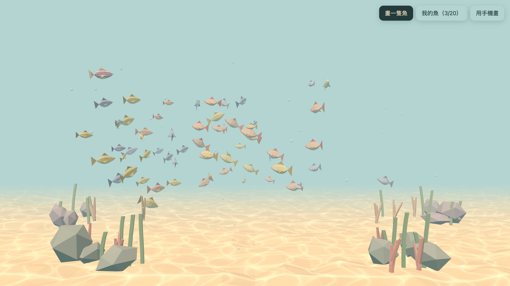
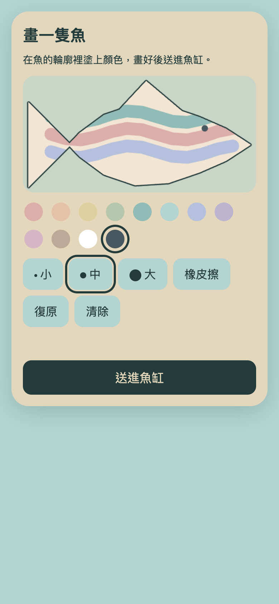
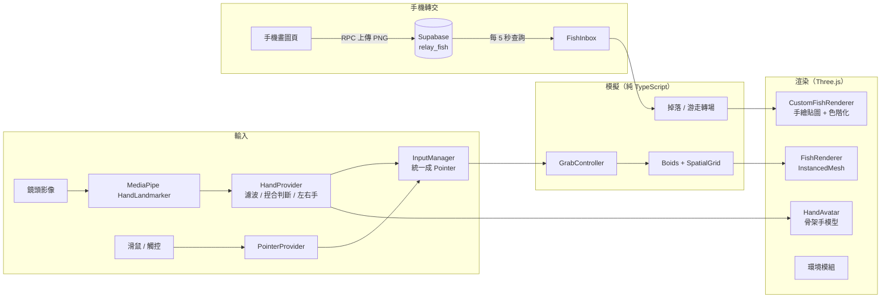

# AI Aquarium

一座在瀏覽器裡的 Cozy Low Poly 3D 魚缸。對著鏡頭伸出手，捏合手指就能抓起小魚；也可以自己畫一條魚放進魚缸，或用手機掃 QR code，把在手機上畫的魚送進桌電的魚缸。

**線上展示：<https://zooroy.github.io/ai-aquarium/>**

- 桌電：可以開鏡頭用手勢玩，或直接用滑鼠玩。
- 手機：用桌電魚缸上「用手機畫」的 QR code 開啟。



<p align="center"></p>

## 功能

| 功能 | 說明 |
|---|---|
| 3D 魚缸 | 全螢幕的 Low Poly 場景，包括沙地、岩石、珊瑚、海草、氣泡和焦散光。60 條魚以 Boids 演算法群游，會閃避游標。 |
| 手勢抓魚 | 用鏡頭追蹤手部，畫面上顯示一隻 3D 手。捏合時抓起最近的魚，魚會驚慌掙扎；放開後牠會逃走。滑鼠和觸控也能抓。 |
| 自己畫魚 | 在魚的側面輪廓上作畫，可選色票、三種筆刷，也有橡皮擦、復原和清除。畫好的花紋會貼到 3D 魚身上一起游。自訂魚保存在瀏覽器，上限 20 隻；滿了會讓最舊的一隻自動游走。 |
| 手機畫魚 | 手機開啟時只顯示畫圖頁，不下載 3D 引擎。用 QR code 配對桌電魚缸，送出後幾秒內，新魚就從畫面上方掉進桌電的魚缸。 |

## 技術棧

- **前端**：TypeScript（strict）、Vite、Three.js
- **手部追蹤**：MediaPipe Tasks Vision（HandLandmarker）
- **儲存**：IndexedDB（本機自訂魚）、Supabase Postgres（手機魚的暫存轉交）
- **測試**：Vitest（252 個測試，node 環境）、PGlite（在測試裡跑真正的 Postgres）
- **部署**：GitHub Pages，由 GitHub Actions 先跑測試，通過後才建置和部署

## 架構



- **模擬和渲染分開**：`src/simulation/`、`src/core/`、`src/input/` 是純 TypeScript，不碰 DOM，也不碰 WebGL，所以可以直接在 node 裡測試。只有 `src/render/` 會用到 WebGL。
- **參數集中管理**：所有可調參數集中在 `src/config/params.ts`，色票集中在 `src/config/palette.ts`。
- **亂數可重現**：亂數一律使用帶種子的 PRNG，網址加上 `?seed=42` 就能重現同一座魚缸。

## 技術重點

### 手勢追蹤：從 21 個關鍵點到穩定的「抓」

- **偵測與渲染分開**：偵測頻率最多 30 Hz，和渲染幀率脫鉤。執行上 GPU 優先，失敗時退回 CPU。
- **抖動與誤判處理**：
  - 用 **One Euro filter** 平滑關鍵點：手不動時抑制抖動，手快速移動時降低延遲。
  - **捏合判斷**：拇指與食指的距離除以手掌大小，所以手離鏡頭遠近都能用。進入門檻 0.25、離開門檻 0.40，用遲滯避免在臨界值附近閃爍。
  - **活動區**：只用畫面中央 70% 的區域對應整個魚缸，手不必伸到鏡頭邊緣。手短暫消失時有 300 ms 的寬限期。
- **左右手判斷**：採用 MediaPipe 的分類結果。送進模型的影像沒有鏡像，MediaPipe Tasks 的標籤就是使用者實際的手，不需要反轉（換成有花紋的手套後才發現先前反轉是錯的）。分數至少 0.7、而且連續 3 幀相同才切換，避免左右手跳來跳去。
- **第一人稱視角**：手的形狀用 `(-x, -y, +z)` 旋轉，而不是鏡像，所以畫面上的手和自己的手一樣，不像照鏡子；游標位置則照常鏡像。

### 骨架手模型

- **只驅動骨頭旋轉（FK）**：手模型是有骨架蒙皮的手套 GLB，保留原本的貼圖。程式把 MediaPipe 的 21 個點對應到骨頭位置，只驅動骨頭的旋轉，骨頭長度保持建模時的比例。
  - 一開始直接把骨頭拉到偵測到的關鍵點上，手形會被拉長變形。
  - glTF 的蒙皮網格不受網格節點本身的 transform 影響，量骨頭和頂點位置時要用蒙皮後的位置。
- **捏合修正**：模型和真人的手指比例不同，只對齊每節方向時，捏合的兩指尖會留一條縫。兩指靠近時，拇指和食指輪流做幾次 CCD IK 互相靠攏，只轉骨頭、不改長度；手張開時不修正。
- **左右手共用一個模型**：只有左手模型，右手用 `scale.x = -1` 鏡像。
- **素材處理**：用 glTF-Transform 刪掉檔案裡多餘的第二隻手，貼圖轉成 WebP，檔案從 1.9 MB 縮到 318 KB。
- **對齊游標**：手的位置以捏合時拇指和食指的中點對齊游標，所以抓魚時，視覺上的手指就落在魚身上。

### 群游與抓取

- **鄰居查詢**：Boids 用 SpatialGrid 查鄰居。對齊和聚合只看最近的 7 個鄰居，分離則看全部近鄰。
- **力的優先順序**：分離力先保留轉向力的額度，其他力只能用剩下的部分，避免聚合力把魚擠在一起。
- **轉向**：用 yaw / pitch 插值，每幀最多轉 30°；俯仰角也有上限，避免經過垂直極點時翻轉。
- **抓取判定**：依每條魚投影到螢幕上的身長計算，而不是固定半徑，所以遠處的小魚和近處的大魚都準。

### 手繪魚：畫在哪裡，魚身上就出現在哪裡

- **輪廓和 UV 同源**：畫布輪廓和 3D 魚身的 UV，都由同一份魚的幾何投影到側面算出來，所以畫布上的筆畫位置和魚身上的位置完全一致；以後換魚的造型也不會對不上。
- **筆畫模型**：筆畫存成正規化座標，和顯示尺寸無關。最多 50 步復原，超過時把最舊的筆畫合併成點陣圖。
- **渲染**：每條自訂魚一個 Mesh，加上自訂的色階化 shader，讓手繪的顏色融入 Low Poly 的平面著色風格。
- **儲存**：IndexedDB 無法使用時（例如部分無痕模式），退回記憶體儲存，並提示「這隻魚不會被保存」。

### 手機轉交：在不綁卡的免費方案上做得安全

- **依裝置載入**：手機和桌電依裝置動態載入不同的 chunk。手機頁不下載 3D 渲染器、MediaPipe 和手模型。
- **配對**：每個魚缸有一個 128 位元的隨機房間代碼，用 QR code 分享。
- **資料表不對外開放**：Supabase 的資料表開了 RLS，但不設任何 policy，並撤銷所有權限。前端只能呼叫 4 個 `security definer` 函式，而且每個都必須帶房間代碼，所以前端無法列出別人的房間。
- **驗證和數量限制都在資料庫裡**：
  - 在 SQL 裡讀 PNG 的檔頭和 IHDR，確認是 512×256 的 PNG，大小不超過 512 KB。
  - 用每個房間各自的 advisory lock 保證待領數量最多 20 隻，同時上傳也不會超過。
  - `pg_cron` 每小時清掉超過一天沒人領的魚。
- **桌電收魚**：
  - 用串接的 `setTimeout` 輪詢，上一輪結束才排下一輪；頁面隱藏時暫停。
  - 本機直接沿用雲端的 id，所以即使「本機存好了、雲端刪除失敗」，下次收到也不會重複。

### 新魚掉落與自動換魚

- **獨立的轉場狀態**：掉落和游走是兩個由程式控制的轉場狀態，用時間驅動的緩出曲線完成。群游和抓取都會略過這兩種狀態的魚，所以掉落中的魚不會被抓走或被魚群推開。
- **水花**：用固定大小的 InstancedMesh 物件池，不會在每次水花時建立新的物件。

## 測試與品質

- **252 個單元測試**：涵蓋模擬、輸入濾波、手部骨架轉換、畫圖模型、儲存、轉交客戶端與輪詢。
- **SQL 用真的 Postgres 測**：資料庫函式在 PGlite（WASM 版 Postgres）裡執行，並以 `anon` 角色呼叫，驗證房間隔離、格式驗證、數量上限、過期清除，以及直接讀取資料表會被拒絕。
- **畫面效果用截圖驗收**：用 Chrome DevTools 實際操作截圖，包括手機尺寸模擬、離線模擬，以及端到端送魚。
- **效能**：60 條魚加上 20 條自訂魚，在 2560×1424 解析度下維持 120 fps。只在 Apple M4 Pro 上量過。

## 開發方式：規格驅動 + AI 協作

這個專案用 [OpenSpec](https://github.com/Fission-AI/OpenSpec) 以規格驅動開發。每個階段先寫好提案、行為規格（含情境）、設計和任務清單，再開始實作；驗收後封存，並把行為需求合併進主規格。

| 階段 | 內容 |
|---|---|
| ① add-aquarium-scene | 3D 魚缸場景與 Boids 群游 |
| ② add-hand-gesture-grab | 手部追蹤、捏合抓魚、3D 手模型 |
| ③ add-custom-fish-drawing | 畫魚、貼圖、保存與管理 |
| ④ add-phone-drawing-relay | 手機畫魚、QR 配對、雲端轉交、部署 |
| ⑤ replace-oldest-custom-fish | 滿了自動換魚、新魚掉落與水花 |

- 主規格放在 `openspec/specs/`，共 12 個能力。歷次變更放在 `openspec/changes/archive/`。
- 開發時使用多個 AI 代理分工：
  - 我負責產品方向、需求取捨和最終驗收。
  - Claude Code 擔任技術 lead，負責架構、規格、拆任務、審查程式碼和瀏覽器驗收。
  - Codex 擔任工程師，依照規格實作並寫測試。
  - 兩個代理之間用 Herdr 派工與回報。
  - 分工規則寫在 [`AGENTS.md`](AGENTS.md)。

## 本機執行

```bash
npm install
npm run dev          # http://localhost:5173
npm test             # 單元測試
npm run typecheck
npm run build
```

網址參數：

| 參數 | 用途 |
|---|---|
| `?seed=42` | 固定亂數種子 |
| `?debug` | 顯示 fps 與互動狀態 |
| `?mode=draw` / `?mode=tank` | 強制切換成手機畫圖頁或魚缸 |

手機畫魚功能需要 Supabase：

1. 建立一個 Supabase 專案，依序在 SQL Editor 執行 `supabase/migrations/` 裡的 SQL。
2. 複製 `.env.example` 為 `.env.local`，填入 Project URL 和 publishable（anon）key。

沒有設定時，「用手機畫」會自動隱藏，其他功能照常運作。

## 專案結構

```text
src/
├── config/      可調參數與色票
├── core/        亂數、魚缸邊界、裝置判斷等純函式
├── input/       滑鼠、觸控、手部追蹤 → 統一的 Pointer
├── simulation/  Boids、抓取、自訂魚、掉落與游走轉場（純 TypeScript）
├── render/      Three.js 場景、魚、手模型、環境效果
├── drawing/     魚的輪廓 / UV 與筆畫模型
├── storage/     IndexedDB 儲存
├── relay/       手機轉交的客戶端、房間代碼、收件匣
├── phone/       手機畫圖頁
└── ui/          面板、選單與整合
supabase/migrations/   轉交用的資料表、函式、權限與排程
openspec/              規格、設計與變更紀錄
tests/                 對應 src/ 結構的單元測試
```

## 已知限制

- 魚缸的 JS bundle 超過 500 KB，MediaPipe 和 Three.js 還可以再拆分。
- 手機頁仍會載入約 57 KB（gzip）的 Three.js 核心，因為魚的輪廓是從 3D 幾何算出來的。
- 效能只在單一機器上量過。
- Supabase 免費專案一週沒有請求會自動暫停，暫停時手機無法送魚，但魚缸照常運作。
- 手機送來的畫沒有內容審查；只有拿到 QR code 的人才能送魚進那個魚缸。
