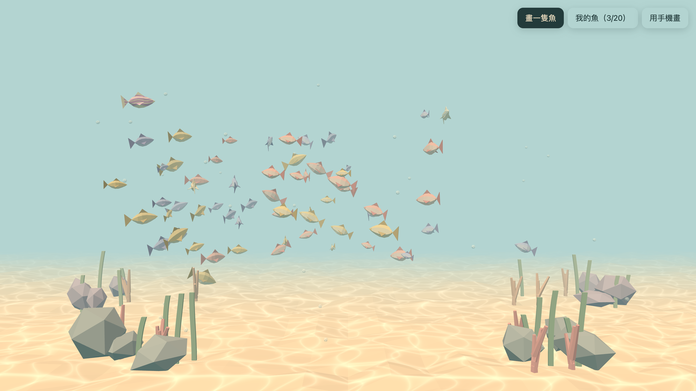

# AI Aquarium

瀏覽器裡的 Low Poly 3D 魚缸：對著鏡頭捏合手指就能抓起小魚，也能自己畫一條魚，或用手機畫好送進桌電的魚缸。

🔗 [Live Demo](https://zooroy.github.io/ai-aquarium/)　｜　免登入；桌電可用鏡頭或滑鼠玩，手機請掃魚缸上的 QR code



## Features
- **手勢抓魚**：鏡頭追蹤手部，畫面上的 3D 手套跟著動；捏合抓魚，握拳讓魚群圍著手繞圈。
- **滑鼠也能玩**：游標就是同一隻手套，左鍵抓魚、右鍵聚魚，可以隨時和鏡頭模式切換。
- **群游魚缸**：60 條魚以 Boids 演算法群游、閃避游標，搭配沙地、珊瑚、氣泡與焦散光。
- **自己畫魚**：在魚的側面輪廓上作畫，花紋會貼到 3D 魚身上一起游，保存在瀏覽器裡。
- **手機畫魚**：掃 QR code 配對，在手機畫好送出，幾秒後新魚從桌電魚缸上方掉進來。

## Tech Stack
- **TypeScript（strict）+ Vite**：手機和桌電依裝置動態載入不同的 chunk，手機頁不下載 3D 渲染器、MediaPipe 與手部模型。
- **Three.js**：60 條魚用 InstancedMesh 一次繪製；骨架蒙皮的手套模型由手部關鍵點驅動骨頭旋轉。
- **MediaPipe Tasks Vision**：在瀏覽器內偵測 21 個手部關鍵點，鏡頭影像不上傳也不儲存。
- **Supabase（Postgres）**：手機魚的暫存轉交。免費方案不需綁卡；PNG 格式驗證與數量上限都在資料庫函式裡完成，前端無法直接讀資料表。
- **IndexedDB**：自訂魚保存在使用者自己的瀏覽器，不需要帳號。

## Verification
- **Static**：TypeScript strict、ESLint（含專案規則：禁用 `any`、禁止直接用 `Math.random()`、純邏輯目錄不得 import 渲染類別）（CI）
- **Test**：Vitest 333 個單元測試、PGlite 跑真正的 Postgres 測 SQL 函式、Playwright 4 個瀏覽器 smoke 測試（CI）
- **Security**：npm audit，正式相依套件有 high 以上漏洞即擋下（CI）
- **Acceptance Evidence**：spec 情境與 e2e 測試對照表，產生 Markdown 驗收報告和 Playwright 報告，上傳為 CI artifact
- **Spec Validation**：以 OpenSpec 規格驅動開發，每個 change 封存前執行 verify
- **Code Review**：Claude Code 擔任 lead 審查 Codex 的實作，分工寫在 [`AGENTS.md`](AGENTS.md)

## Getting Started
```bash
npm install
cp .env.example .env.local   # 選用：填入 Supabase 才會啟用手機畫魚
npm run dev
```

架構、手勢與骨架細節、轉交的安全設計和已知限制，請見 [技術筆記](docs/technical-notes.md)。
